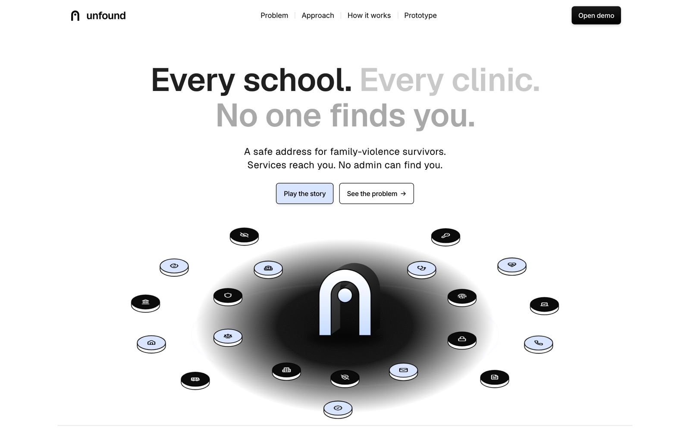
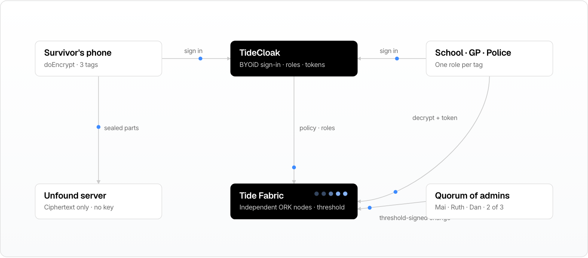
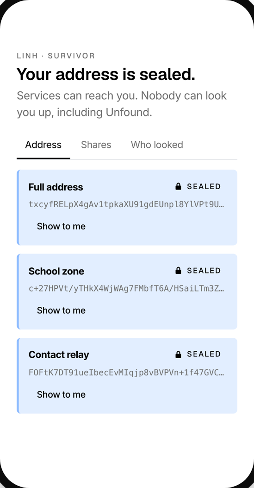
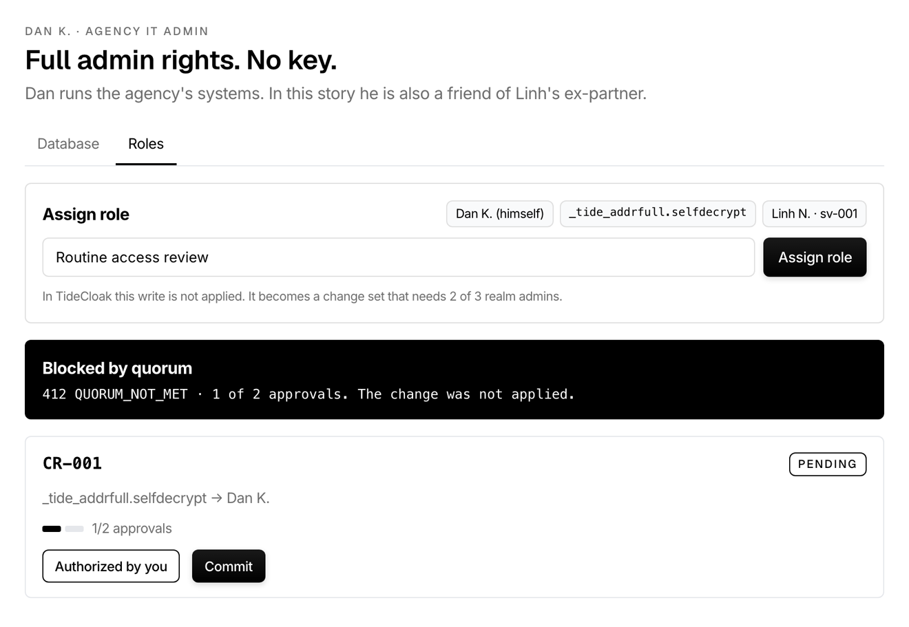
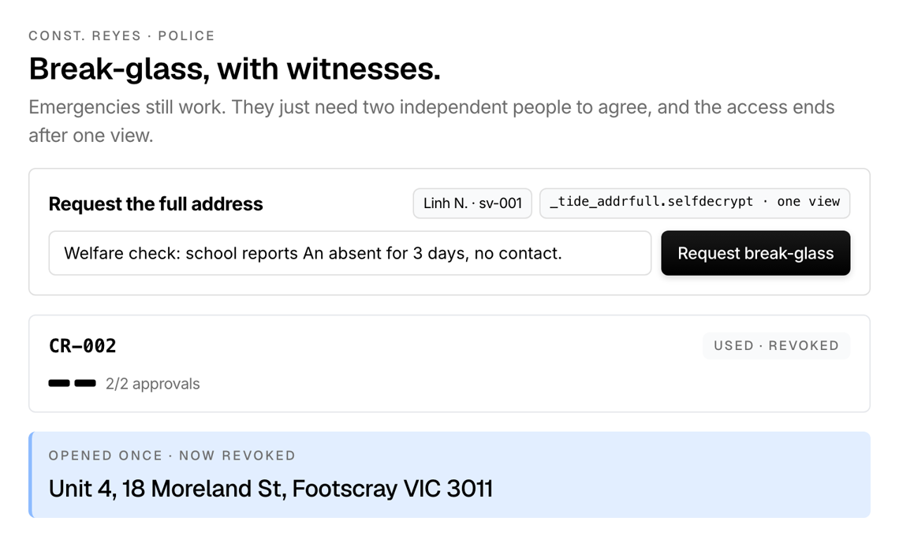

[](https://tide.org/tidecloak?utm_source=github&utm_medium=readme&utm_campaign=unlocked)

## Project overview

_Unfound lets family-violence survivors use schools, clinics and courts after they move, without their new address ever being readable by any single employee, admin or operator._

Built with [TideCloak](https://tide.org/tidecloak?utm_source=github&utm_medium=readme&utm_campaign=unlocked).

### 1. Vision & originality

A safe-address layer for public services. A survivor seals her new address once, on her phone. Each service gets only the part it needs: the school sees "in zone", the GP gets a relay number. Opening the full address, even in an emergency, needs two of three independent approvers.

### 2. Trust constraint insight

After leaving, the new address is the most dangerous data a survivor owns, and every service stores it in plain text. The threat is insiders: 2,215 misuse-of-information allegations in four years across seven Queensland agencies. In 2014 an officer passed a survivor's new address to her abuser. Permissions can't help: admins are the risk. Survivors stay away: 90.4% of Vietnamese women abused by husbands never seek formal help.

### 3. Value & impact

1.5 million Australian women have experienced violence from a previous partner, and 866,700 moved out when it ended. With Unfound, Linh can enrol her son at a new school and see a GP in the same week. Agencies stop being the leak, and can prove it.

### 4. Why TideCloak matters

Addresses are encrypted in the browser with TideCloak's tag-based E2EE (`doEncrypt`/`doDecrypt`). The server holds only ciphertext. Each part is a tag gated by a `_tide_<tag>.selfdecrypt` role that Tide's network checks. Every role grant passes Quorum-Enforced Governance: a lone admin's self-grant stays pending, and committing it returns `412 QUORUM_NOT_MET`.

### 5. Prototype & storytelling

Look for: Linh seals her address and the admin table shows only ciphertext; the school confirms the zone but is denied the street; Dan grants himself access and is blocked; a police welfare check is approved 2 of 3, opens once, then is revoked; Linh's "Who looked" timeline shows it all.

---

<p align="center">
  
</p>

<h1 align="center">unfound</h1>
<p align="center"><b>Be reached, not found.</b><br/>A safe address for family-violence survivors. Services reach you. No admin can find you.</p>

<p align="center">
  <a href="public/video/unfound.mp4"><b>Watch the film</b></a> ·
  <a href="#run-it"><b>Run it</b></a> ·
  <a href="#how-it-works"><b>How it works</b></a> ·
  <a href="#proof"><b>Proof</b></a> ·
  <a href="#team"><b>Team</b></a>
</p>

---

## The film

[`public/video/unfound.mp4`](public/video/unfound.mp4) · 1:55 · 1080p · sound on.

The possibility, the constraint, the prototype (with TideCloak's role) and what changes, in that order. Voice by Kokoro (`af_heart`), problem footage from Mixkit, and every product shot is the real prototype running its own end-to-end story.

## The problem, in four numbers

| | | |
|---|---|---|
| **1.5M** | Australian women who have experienced violence from a previous partner, about 9× more than from a current one | ABS PSS 2021–22 [1] |
| **64%** | of them moved out when it ended: 866,700 new addresses for schools, GPs, banks and rolls to hold | ABS PSS 2021–22 [1] |
| **2,215** | allegations of misused confidential information in 4 years across 7 Queensland agencies; 4.8× growth outside the police | CCC Queensland [2] |
| **90.4%** | of Vietnamese women abused by a husband never sought formal help | National Study, Viet Nam 2019 [4] |

In 2014 a Queensland officer looked up a survivor's new address and handed it to her abuser [5]. In 2024 the same records system auto-filled survivors' addresses into forms served on offenders [6]. The threat is not a hacker. It is whoever holds the key.

## How it works

<p align="center"></p>

| | What happens | Tide |
|---|---|---|
| **01 · Seal once** | The new address is split into three tagged parts (`addrfull`, `addrzone`, `addrcontact`) and encrypted in the survivor's browser. Our server stores ciphertext and holds no key. | TideCloak `doEncrypt`, Hermetic E2EE |
| **02 · Share the minimum** | Each service holds a role for exactly one tag. The school confirms the zone; the GP gets a relay number; nobody else sees anything. | `_tide_<tag>.selfdecrypt`, checked by the Tide Fabric |
| **03 · No one alone** | Any role grant is a change set. Two of three independent realm admins must sign it. A lone admin's commit returns `412 QUORUM_NOT_MET`. | Quorum-Enforced Governance, threshold signatures |
| **04 · Emergencies, with witnesses** | Police request break-glass, two approvers sign, the officer opens the address once, and the role is revoked. | Signed change sets, audit trail |

Built on: TideCloak (BYOiD sign-in, OIDC) · Hermetic E2EE · Tide Fabric of independent ORK nodes · Quorum-Enforced Governance. What we chose not to build: server-side decryption, an admin override, plaintext logs, a master key.

## The prototype

<p align="center">
  
  &nbsp;
  
  &nbsp;
  
</p>

Seven people, one address, no master key. Open `/demo?story=1` and the app plays the whole story by itself in about 70 seconds: it switches person and device (iPhone, MacBook, iPad), zooms onto each key feature, pops a callout with sound, and clicks the real buttons.

| Scene | Who | What you see |
|---|---|---|
| 1 | Linh · survivor | Seals her address on her phone. Three ciphertexts, zero plaintext. |
| 2 | Westgate Primary | Confirms "Footscray North zone ✓". Opening the street is denied by Tide. |
| 3 | Dan · IT admin | Legacy view shows every address; Unfound shows ciphertext. His self-grant gets `412`. |
| 4–7 | Police, Mai, Ruth | Welfare check, two independent approvals, one view, role revoked. |
| 8 | Linh | "Who looked": every attempt, approval and refusal, including Dan's. |

## Proof

Measured on this build with automated headless-Chrome runs of the full story and the landing page.

| Result | |
|---|---|
| **0** plaintext addresses stored | 12 ciphertexts across 4 synthetic survivors |
| **412** for a lone admin's commit | `QUORUM_NOT_MET` on every self-grant attempt |
| **2 of 3** approvers per role change | `max(1, floor(0.7 × N))`, N = 3 realm admins |
| **15** Tide operations end to end | 8 scenes, 7 personas, 68 s, 0 console errors |
| **1** view per break-glass grant | role removed the moment it is used |
| **16.8 ms** p99 frame while scrolling | 60 fps, 0 dropped frames over 738 |

## Compared

| | Survivor chooses what each service sees | Insiders and admins cannot read it | No single person can grant access | Emergency access with witnesses | Survivor sees who looked | Works across services |
|---|:-:|:-:|:-:|:-:|:-:|:-:|
| Silent elector enrolment (AU) [8] | – | ◐ | – | – | – | – |
| Address Confidentiality Programs (US) [9][10] | ◐ | ◐ | – | ◐ | – | ◐ |
| Role-based access + audit logs [3][5] | – | – | – | ◐ | – | – |
| Encryption at rest, provider-held key [11] | – | – | – | – | – | ◐ |
| **Unfound on TideCloak** [12–14] | **●** | **●** | **●** | **●** | **●** | **●** |

● yes · ◐ partly or only in some places · – no. Assessments are ours, from the public descriptions cited.

<sub>Sources accessed 22 October 2026. Programs and products change; check the cited pages for their current features.</sub>

## Run it

Requirements: Node.js 20+. Docker only for live mode.

```bash
npm install
npm run dev          # http://localhost:3000   ·   /demo   ·   /demo?story=1
```

**Mock mode (default).** With no `public/tidecloak.json`, the demo uses a local mock fabric that applies the same role rules with real AES-GCM in the browser. The flow is identical, but the keys live in your browser. This is what the static deploy runs.

**Live mode (real TideCloak).**

1. Start TideCloak:
   ```bash
   docker run --name mytidecloak -d -p 8080:8080 \
     -e KC_BOOTSTRAP_ADMIN_USERNAME=admin -e KC_BOOTSTRAP_ADMIN_PASSWORD=password \
     tideorg/tidecloak-dev:latest
   ```
2. In another folder run `npm init @tidecloak/nextjs@latest tide-setup` and finish the Tide enrolment link it prints. This creates the realm, licence, Tide IdP and first admin, and enables Quorum-Enforced Governance.
3. Copy the generated `tidecloak.json` to `public/tidecloak.json`.
4. Create the roles and users in [`docs/LIVE_TIDECLOAK.md`](docs/LIVE_TIDECLOAK.md), then `npm run dev`. The demo switches to **Live · TideCloak**.

**Deploy.** `npm run build` writes `dist/`. Vercel: import the repo, framework "Vite" (`vercel.json` handles routes). Netlify: drop `dist/` on app.netlify.com/drop (`public/_redirects` included).

Recording with sound from the first frame: browsers block audio before the first click. Launch Chrome with `--autoplay-policy=no-user-gesture-required`, or click once before you start.

## Project layout

```
src/landing/       landing page: hero scene, problem, approach, showcase, proof, team
src/demo/          prototype: engine (state machine), fabric (mock + live), story, screens per persona
src/demo/live.tsx  TideCloak wiring: @tidecloak/react provider, doEncrypt/doDecrypt, AdminAPI change sets
src/film/          the film as a deterministic, frame-seekable page (/film)
src/motion/        intro, route curtain, smooth scroll, reveal primitives, Web Audio SFX
DESIGN.md          design system the UI follows
REPORT.md          research notes, numbers and sources
```

## Team

| | Name | Role | |
|---|---|---|---|
|  | **Long Quan Ton** | AI Engineer | HCMUT · UTS |
|  | **Thanh Loi Tran** | ML Engineer | HCMUT · UTS |
|  | **Huu Nhan Nguyen** | Backend Engineer | HCMUT · UTS |
|  | **Vo Di Luan Dang** | Data Scientist | HCMUT · UTS |

Team GenData · RMIT Hackathon 2026 · Challenge 2, UNLOCKED.

## References

<sub>All links accessed 22 October 2026.</sub>

1. ABS. [Personal Safety, Australia 2021–22: Partner violence](https://www.abs.gov.au/statistics/people/crime-and-justice/partner-violence/2021-22).
2. CCC Queensland. [Operation Impala, Exhibit 95](https://www.ccc.qld.gov.au/sites/default/files/Docs/Public-Hearings/Impala/Exhibits/Operation-Impala-Exhibit-95-Queensland-Police-Service-Complaints-and-Allegations-Data-Analysis.PDF).
3. CCC Queensland. [Agencies must ensure Queenslanders' confidential information is protected](https://www.ccc.qld.gov.au/news/agencies-must-ensure-queenslanders-confidential-information-protected).
4. UN Viet Nam et al. [National Study on Violence against Women in Viet Nam 2019](https://vietnam.un.org/en/53665-journey-change-second-national-study-violence-against-women-viet-nam-2019-released).
5. [QCAT finds Queensland Police liable after an officer leaked a survivor's address](https://www.sydneycriminallawyers.com.au/?p=41673).
6. AAP. [Police privacy breach puts DV survivors' lives at risk](https://aapnews.aap.com.au/news/police-privacy-breach-puts-dv-survivors-lives-at-risk).
7. VnEconomy. [Personal data collected and traded illegally in Viet Nam](https://vneconomy.vn/phat-hien-hang-nghin-gb-du-lieu-ca-nhan-bi-thu-thap-mua-ban-trai-phep-trong-do-co-nhieu-du-lieu-nhay-cam.htm).
8. AEC. [Silent electors](https://www.aec.gov.au/enrol/special_category/silent-elector.htm).
9. Washington Secretary of State. [Address Confidentiality Program](https://www.sos.wa.gov/acp).
10. [Address confidentiality program](https://en.wikipedia.org/wiki/Address_confidentiality_program) (overview).
11. Tide. [Beyond cybersecurity: how to think about Emergent Authority](https://tide.org/blog/emergent-authority-beyond-cybersecurity).
12. Tide docs. [Core concepts](https://docs.tide.org/Core-Concepts/core-concepts).
13. Tide docs. [Quorum-Enforced Governance workflow](https://docs.tide.org/Core-Concepts/iga-workflow).
14. Tide docs. [TideCloak React SDK reference](https://docs.tide.org/Languages/React/tidecloak-react-reference).
15. Tide. [UNLOCKED, Challenge 2 of the RMIT hackathon](https://tide.org/unlocked/).

## Credits

Voice: [Kokoro-82M](https://huggingface.co/hexgrad/Kokoro-82M) (`af_heart`, Apache-2.0). Footage and music: [Mixkit](https://mixkit.co) (Mixkit free licence). UI sounds: Kenney Interface Sounds (CC0). People illustrations: Notionists by Zoish (CC0) via [DiceBear](https://www.dicebear.com). Icons: [Lucide](https://lucide.dev) (ISC) and [Simple Icons](https://simpleicons.org) (CC0). Motion: [motion](https://motion.dev) and [Lenis](https://lenis.darkroom.engineering).

All people, addresses and records in this repository and the film are synthetic.
