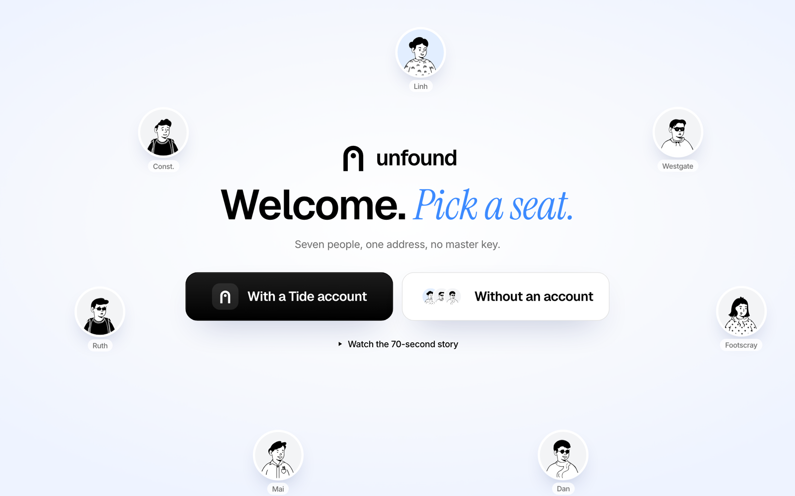
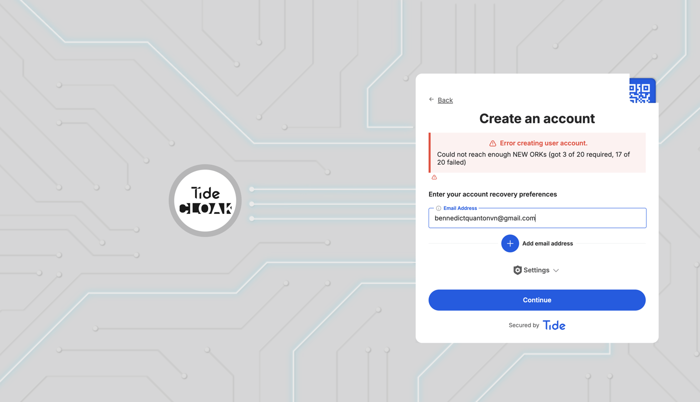
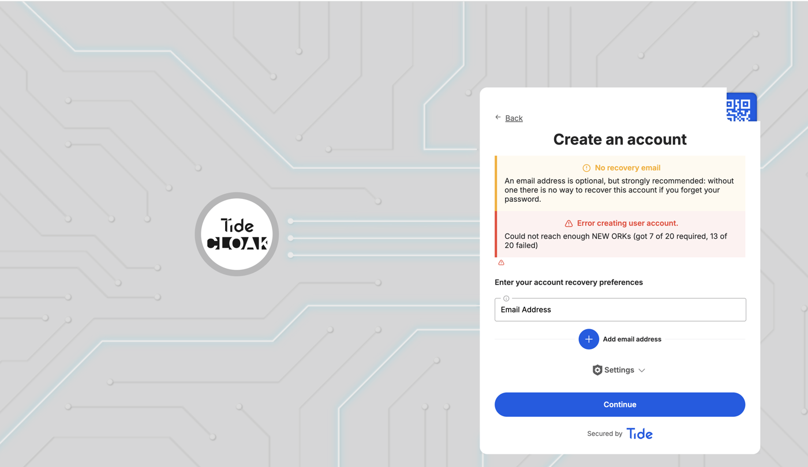

[](https://tide.org/tidecloak?utm_source=github&utm_medium=readme&utm_campaign=unlocked)

## Project overview

_Unfound is a safe-address layer for family-violence survivors: schools, clinics and courts can reach them after they move, and no single employee, admin or operator can find them._

Built with [TideCloak](https://tide.org/tidecloak?utm_source=github&utm_medium=readme&utm_campaign=unlocked).

### 1. Vision & originality

A survivor seals her new address once, on her phone. Each service gets only the part it needs: the school learns "in zone", the GP gets a relay number, court mail opens the street only as the label prints. Opening the full address, even in an emergency, takes two of three independent approvers, for one view.

### 2. Trust constraint insight

After leaving, the new address is the most dangerous data a survivor owns, and every service keeps it in plain text. The threat is insiders, not hackers: 2,215 misuse-of-information allegations in four years across seven Queensland agencies [2]. In 2014 an officer passed a survivor's new address to her abuser [5]. Permissions cannot fix this, because admins are the risk.

### 3. Value & impact

1.5 million Australian women have experienced violence from a former partner, and 866,700 moved out when it ended [1]. In Viet Nam, 90.4% of women abused by a husband never seek formal help [4]. With Unfound, Linh enrols her son and sees a GP the same week without creating a new way to be found.

### 4. Why TideCloak matters

TideCloak encrypts each part in the browser (`doEncrypt`, tag-based E2EE); our server holds ciphertext and no key. A `_tide_<tag>.selfdecrypt` role, checked by Tide's network, decides who opens which part. Every role grant is a Quorum-Enforced Governance change set: a lone admin's self-grant stays pending, and committing it returns `412 QUORUM_NOT_MET`.

### 5. Prototype & storytelling

Open `/demo?story=1`: Linh's database holds only ciphertext; the school confirms the zone but is denied the street; Dan's self-grant is blocked; a welfare check is approved 2 of 3, opened once, revoked; Linh's "Who looked" log shows it all. Measured: 15 Tide operations, 0 plaintext addresses, 68 s.

---

<p align="center">
  
</p>

<h1 align="center">unfound</h1>
<p align="center"><b>Be reached, not found.</b><br/>A safe address for family-violence survivors. Services reach you. No admin can find you.</p>

<p align="center">
  <a href="public/video/unfound.mp4"><b>Watch the film</b></a> ·
  <a href="#setup"><b>Setup</b></a> ·
  <a href="#how-it-works"><b>How it works</b></a> ·
  <a href="#proof"><b>Proof</b></a> ·
  <a href="#team"><b>Team</b></a>
</p>

---

> **Note for judges.** Live Tide sign-in could not be completed: on 22 Oct 2026 Tide's enclave failed to create the first account on every attempt ("Could not reach enough NEW ORKs", 13–17 of 20 ORKs failing). The TideCloak integration is in the code and the realm was provisioned and licensed; the film and the deploy run on the mock fabric. Evidence and details in [Setup](#setup).

## The film

[`public/video/unfound.mp4`](public/video/unfound.mp4) · 1:55 · 1080p · sound on.

The possibility, the constraint, the prototype (with TideCloak's role) and what changes, in that order. Voice by Kokoro (`af_heart`), problem footage from Mixkit, and every product shot is the real prototype running its own end-to-end story.

## How it works

<p align="center"></p>

| | What happens | Tide |
|---|---|---|
| **01 · Seal once** | The new address is split into three tagged parts (`addrfull`, `addrzone`, `addrcontact`) and encrypted in the survivor's browser. Our server stores ciphertext and holds no key. | TideCloak `doEncrypt`, Hermetic E2EE |
| **02 · Share the minimum** | Each service holds a role for exactly one tag. The school confirms the zone; the GP gets a relay number; nobody else sees anything. | `_tide_<tag>.selfdecrypt`, checked by the Tide Fabric |
| **03 · No one alone** | Any role grant is a change set. Two of three independent realm admins must sign it. A lone admin's commit returns `412 QUORUM_NOT_MET`. | Quorum-Enforced Governance, threshold signatures |
| **04 · Emergencies, with witnesses** | Police request break-glass, two approvers sign, the officer opens the address once, and the role is revoked. | Signed change sets, audit trail |

Built on: TideCloak (BYOiD sign-in, OIDC) · Hermetic E2EE · Tide Fabric of independent ORK nodes · Quorum-Enforced Governance. What we chose not to build: server-side decryption, an admin override, plaintext logs, a master key.

## The prototype

<p align="center">
  
  &nbsp;
  
  &nbsp;
  
</p>

<p align="center"></p>

Seven people, one address, no master key. `/demo` opens on a welcome screen: **With a Tide account** (live TideCloak) or **Without an account** (mock fabric). Open `/demo?story=1` and the app plays the whole story by itself in about 70 seconds: it switches person and device (iPhone, MacBook, iPad), zooms onto each key feature, pops a callout with sound, and clicks the real buttons.

| Scene | Who | What you see |
|---|---|---|
| 1 | Linh · survivor | Seals her address on her phone. Three ciphertexts, zero plaintext. |
| 2 | Westgate Primary | Confirms "Footscray North zone ✓". Opening the street is denied by Tide. |
| 3 | Dan · IT admin | Legacy view shows every address; Unfound shows ciphertext. His self-grant gets `412`. |
| 4–7 | Police, Mai, Ruth | Welfare check, two independent approvals, one view, role revoked. |
| 8 | Linh | "Who looked": every attempt, approval and refusal, including Dan's. |

## Compared

| | Survivor chooses what each service sees | Insiders and admins cannot read it | No single person can grant access | Emergency access with witnesses | Survivor sees who looked | Works across services |
|---|:-:|:-:|:-:|:-:|:-:|:-:|
| Silent elector enrolment (AU) [8] | – | ◐ | – | – | – | – |
| Address Confidentiality Programs (US) [9][10] | ◐ | ◐ | – | ◐ | – | ◐ |
| Role-based access + audit logs [3][5] | – | – | – | ◐ | – | – |
| Encryption at rest, provider-held key [11] | – | – | – | – | – | ◐ |
| **Unfound on TideCloak** [12–14] | **●** | **●** | **●** | **●** | **●** | **●** |

● yes · ◐ partly or only in some places · – no. Assessments are ours, from the public descriptions cited.

<sub>Sources accessed 22 October 2026. Programs and products change; check the cited pages for their current features.</sub>

## Setup

Requirements: Node.js 20+. Docker for the live TideCloak mode.

**Just look around (no account, no server).**

```bash
npm install && npm run dev        # http://localhost:3000 · /demo · /demo?story=1
```

`/demo` opens on a welcome screen with two doors. **Without an account** runs the full flow on a local mock fabric that applies the same role rules with real AES-GCM in the browser (keys live in your browser, so it proves the experience, not the security). This is what the public Vercel deploy runs.

**With a Tide account (real TideCloak, one command).**

```bash
cp .env.example .env              # your licence email, TIDE_TERMS_ACCEPTED=yes after reading tide.org/legal, a local admin password
bash scripts/setup-local.sh
```

The script installs dependencies, adds Tide's MCP server to Claude Code (`claude mcp add --transport http tide https://mcp.tide.org/mcp`), starts TideCloak in Docker, provisions a licensed Tide realm with Quorum-Enforced Governance, waits while you enrol your Tide account in the browser, copies `tidecloak.json` into the app, creates the six `_tide_addr*` roles, and starts the app. Then choose **With a Tide account** on `/demo`: sealing calls `doEncrypt` and opening calls `doDecrypt` on Tide's network. Details and manual steps: [`docs/LIVE_TIDECLOAK.md`](docs/LIVE_TIDECLOAK.md).

A realm running in Docker only serves your own machine. For other people to sign in with Tide on a public URL, the realm has to run on hosted TideCloak (Skycloak) instead; the app wiring is identical.

**⚠️ Live Tide sign-in could not be completed during the hackathon (22 Oct 2026).** We provisioned a licensed realm on local TideCloak (`unfound1`: licence active, Quorum-Enforced Governance on), then tried to create the first Tide account many times between 16:20 and 17:00 (UTC+7). Every attempt failed inside Tide's enclave because most of Tide's ORK network did not respond:

<p align="center">
  
  
</p>

Earlier licence attempts on the same day returned *"Midgard.FinalizeWallet: Not enough orks returned an ok response"* before one succeeded. Without an enrolled Tide account there is no admin and no user to sign in, so the live mode cannot run yet. Everything on our side is in place: the live code path (`src/demo/live.tsx`: TideCloak sign-in, `doEncrypt`/`doDecrypt`, AdminAPI change sets) switches on as soon as `public/tidecloak.json` holds a realm, and `scripts/setup-local.sh` reproduces the whole setup once Tide's network is healthy. **The film and the public deploy therefore run on the mock fabric**, which applies the same role and quorum rules.

If provisioning stops with `KEYGEN_FAILED` / "Not enough orks returned an ok response", Tide's network could not activate the licence at that moment. Wait a minute, set `TIDE_REALM` to a new name and rerun.

**Deploy.** `npm run build` writes `dist/`. Vercel: import the repo, framework "Vite" (`vercel.json` handles routes). Netlify: drop `dist/` on app.netlify.com/drop (`public/_redirects` included).

## Project layout

```
src/landing/       landing page: hero scene, problem, approach, showcase, proof, team
src/demo/          prototype: engine (state machine), fabric (mock + live), story, screens per persona
src/demo/live.tsx  TideCloak wiring: @tidecloak/react provider, doEncrypt/doDecrypt, AdminAPI change sets
src/film/          the film as a deterministic, frame-seekable page (/film)
src/motion/        intro, page morph, smooth scroll, reveal primitives, Web Audio SFX
scripts/           setup-local.sh: one-command local setup with TideCloak and Tide MCP
tools/             tide-setup.mjs: wire a realm into the app (adapter + roles)
DESIGN.md          design system the UI follows
REPORT.md          research notes, numbers and sources
```

## Team

| | Name | Role | |
|---|---|---|---|
|  | **Long Quan Ton** | AI Engineer | HCMUT · UTS |
|  | **Thanh Loi Tran** | ML Engineer | HCMUT · UTS |
|  | **Huu Nhan Nguyen** | Backend Engineer | HCMUT · UTS |
|  | **Vo Di Luan Dang** | Data Scientist | HCMUT · UTS |

Team GenData · RMIT Hackathon 2026 · Challenge 2, UNLOCKED.

## References

<sub>All links accessed 22 October 2026.</sub>

1. ABS. [Personal Safety, Australia 2021–22: Partner violence](https://www.abs.gov.au/statistics/people/crime-and-justice/partner-violence/2021-22).
2. CCC Queensland. [Operation Impala, Exhibit 95](https://www.ccc.qld.gov.au/sites/default/files/Docs/Public-Hearings/Impala/Exhibits/Operation-Impala-Exhibit-95-Queensland-Police-Service-Complaints-and-Allegations-Data-Analysis.PDF).
3. CCC Queensland. [Agencies must ensure Queenslanders' confidential information is protected](https://www.ccc.qld.gov.au/news/agencies-must-ensure-queenslanders-confidential-information-protected).
4. UN Viet Nam et al. [National Study on Violence against Women in Viet Nam 2019](https://vietnam.un.org/en/53665-journey-change-second-national-study-violence-against-women-viet-nam-2019-released).
5. [QCAT finds Queensland Police liable after an officer leaked a survivor's address](https://www.sydneycriminallawyers.com.au/?p=41673).
6. AAP. [Police privacy breach puts DV survivors' lives at risk](https://aapnews.aap.com.au/news/police-privacy-breach-puts-dv-survivors-lives-at-risk).
7. VnEconomy. [Personal data collected and traded illegally in Viet Nam](https://vneconomy.vn/phat-hien-hang-nghin-gb-du-lieu-ca-nhan-bi-thu-thap-mua-ban-trai-phep-trong-do-co-nhieu-du-lieu-nhay-cam.htm).
8. AEC. [Silent electors](https://www.aec.gov.au/enrol/special_category/silent-elector.htm).
9. Washington Secretary of State. [Address Confidentiality Program](https://www.sos.wa.gov/acp).
10. [Address confidentiality program](https://en.wikipedia.org/wiki/Address_confidentiality_program) (overview).
11. Tide. [Beyond cybersecurity: how to think about Emergent Authority](https://tide.org/blog/emergent-authority-beyond-cybersecurity).
12. Tide docs. [Core concepts](https://docs.tide.org/Core-Concepts/core-concepts).
13. Tide docs. [Quorum-Enforced Governance workflow](https://docs.tide.org/Core-Concepts/iga-workflow).
14. Tide docs. [TideCloak React SDK reference](https://docs.tide.org/Languages/React/tidecloak-react-reference).
15. Tide. [UNLOCKED, Challenge 2 of the RMIT hackathon](https://tide.org/unlocked/).

## Credits

Voice: [Kokoro-82M](https://huggingface.co/hexgrad/Kokoro-82M) (`af_heart`, Apache-2.0). Footage and music: [Mixkit](https://mixkit.co) (Mixkit free licence). UI sounds: Kenney Interface Sounds (CC0). People illustrations: Notionists by Zoish (CC0) via [DiceBear](https://www.dicebear.com). Icons: [Lucide](https://lucide.dev) (ISC) and [Simple Icons](https://simpleicons.org) (CC0). Motion: [motion](https://motion.dev) and [Lenis](https://lenis.darkroom.engineering).

All people, addresses and records in this repository and the film are synthetic.
